<!--
  ETHICALLEMON
  GitHub profile README
-->

<p align="center">
  
</p>

<p align="center">
  <a href="#about">About</a>
  &nbsp;&nbsp;&nbsp;
  <a href="#selected-work">Selected Work</a>
  &nbsp;&nbsp;&nbsp;
  <a href="#stack">Stack</a>
  &nbsp;&nbsp;&nbsp;
  <a href="#activity">Activity</a>
</p>

<p align="center">
  
</p>

---

<a id="about"></a>

## About

I am Lemuel, a student developer from India building full-stack applications, operational tools and automation systems.

Most of my work is connected to aviation technology, booking workflows, staff management, Discord integrations and modern web interfaces. I prefer building complete systems over isolated demos: frontend, backend, authentication, database structure, deployment and the small details that make a product usable.

```text
Current focus     Building cleaner full-stack applications
Main project      Virtual airline operations and booking platform
Interested in     Aviation technology, security and interface design
Working style     Build, test, refine and ship
```

---

<a id="selected-work"></a>

## Selected Work

<table>
  <tr>
    <td width="50%" valign="top">
      <a href="https://github.com/EthicalLemon/INDIGO-PTFS">
        
      </a>
    </td>
    <td width="50%" valign="top">
      <a href="https://github.com/EthicalLemon/indigoptfs">
        
      </a>
    </td>
  </tr>
  <tr>
    <td width="50%" valign="top">
      <a href="https://github.com/EthicalLemon/indigoo">
        
      </a>
    </td>
    <td width="50%" valign="top">
      <a href="https://github.com/EthicalLemon/Lemon">
        
      </a>
    </td>
  </tr>
</table>

### Indigo PTFS

A virtual airline operations platform designed around real workflows rather than static pages.

```text
Passenger systems     Flight search, booking, check-in and e-tickets
Operations systems    Flight creation, status control and manifests
Staff systems         Role-based dashboards and permissions
Data layer            Supabase, PostgreSQL and real-time updates
Automation            Discord bot commands and notifications
```

---

<a id="stack"></a>

## Stack

<p align="center">
  
</p>

<table>
  <tr>
    <td width="33%" valign="top">
      <strong>Frontend</strong>
      <br><br>
      HTML<br>
      CSS<br>
      JavaScript<br>
      TypeScript<br>
      React<br>
      Next.js<br>
      Tailwind CSS
    </td>
    <td width="33%" valign="top">
      <strong>Backend</strong>
      <br><br>
      Node.js<br>
      Supabase<br>
      PostgreSQL<br>
      Authentication<br>
      Role-based access<br>
      Real-time data<br>
      Discord integrations
    </td>
    <td width="33%" valign="top">
      <strong>Workflow</strong>
      <br><br>
      Git<br>
      GitHub<br>
      Figma<br>
      Vercel<br>
      Netlify<br>
      Responsive design<br>
      Interface prototyping
    </td>
  </tr>
</table>

---

## What I am improving

```text
01   Writing cleaner TypeScript and reusable components
02   Designing secure authentication and permission systems
03   Structuring databases for real operational workflows
04   Building interfaces that remain clear as features expand
05   Moving projects from prototypes into reliable deployments
```

---

## How I build

```mermaid
flowchart LR
    A[Problem] --> B[Research]
    B --> C[Prototype]
    C --> D[Frontend]
    D --> E[Backend]
    E --> F[Testing]
    F --> G[Deployment]
    G --> H[Refinement]

    style A fill:#0d1117,stroke:#30363d,color:#c9d1d9
    style B fill:#0d1117,stroke:#30363d,color:#c9d1d9
    style C fill:#0d1117,stroke:#30363d,color:#c9d1d9
    style D fill:#0d1117,stroke:#58a6ff,color:#c9d1d9
    style E fill:#0d1117,stroke:#58a6ff,color:#c9d1d9
    style F fill:#0d1117,stroke:#30363d,color:#c9d1d9
    style G fill:#0d1117,stroke:#30363d,color:#c9d1d9
    style H fill:#0d1117,stroke:#30363d,color:#c9d1d9
```



---

<a id="activity"></a>

## Activity

<p align="center">
  
</p>

<table>
  <tr>
    <td width="50%" valign="top">
      
    </td>
    <td width="50%" valign="top">
      
    </td>
  </tr>
</table>

<p align="center">
  
</p>

---

## Repository directory

| Project                                                    | Purpose                             | Status              |
| ---------------------------------------------------------- | ----------------------------------- | ------------------- |
| [INDIGO-PTFS](https://github.com/EthicalLemon/INDIGO-PTFS) | Virtual airline operations platform | Active development  |
| [indigoptfs](https://github.com/EthicalLemon/indigoptfs)   | Airline web and backend systems     | Active development  |
| [indigoo](https://github.com/EthicalLemon/indigoo)         | Booking and check-in interface      | Deployed experiment |
| [Lemon](https://github.com/EthicalLemon/Lemon)             | Personal development laboratory     | Experimental        |

---

## Current direction

I am working towards becoming a stronger full-stack developer by building projects that have real users, real operational requirements and real technical constraints.

The goal is not to display the largest possible collection of tools. The goal is to understand the tools well enough to design and operate complete systems.

---

<p align="center">
  <sub>
    Build useful systems. Keep the interface clear. Improve every release.
  </sub>
</p>
